<!-- Contribution Garden: generated assets are refreshed by GitHub Actions. -->
<picture>
  <source media="(prefers-color-scheme: dark)" srcset="./assets/contributions-dark.svg">
  <source media="(prefers-color-scheme: light)" srcset="./assets/contributions-light.svg">
  
</picture>

실제 GitHub 기여 기록 · 매일 자동 갱신 · <a href="https://github.com/internalforces/internalforces/actions/workflows/contribution-garden.yml">업데이트 상태</a>

